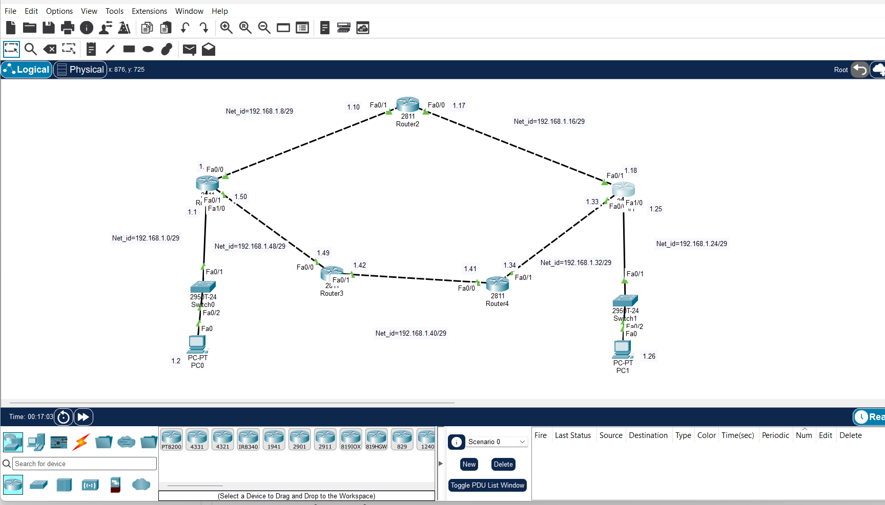

# EIGRP Lab

## Objective
Configure EIGRP (AS 200) dynamic routing between 5 routers in Cisco Packet Tracer so that PC0 and PC1 can communicate.

## Topology


## Network Details

| Network | Connected Devices |
|---------|-------------------|
| 192.168.1.0/29 | Router1 - Switch0 - PC0 |
| 192.168.1.8/29 | Router1 - Router2 |
| 192.168.1.16/29 | Router2 - Router5 |
| 192.168.1.24/29 | Router5 - Switch1 - PC1 |
| 192.168.1.32/29 | Router5 - Router4 |
| 192.168.1.40/29 | Router4 - Router3 |
| 192.168.1.48/29 | Router3 - Router1 |

## Commands Used

Run on every router:

```
Router> enable
Router# configure terminal
Router(config)# router eigrp 200
Router(config-router)# network 192.168.1.0
Router(config-router)# end
Router# write memory
```

## Command Explanation

| Command | Purpose |
|---------|---------|
| `router eigrp 200` | Starts EIGRP with AS number 200 (must match on all routers) |
| `network 192.168.1.0` | Enables EIGRP on all interfaces in 192.168.1.0 |

## Verification

```
Router# show ip eigrp neighbors
Router# show ip route eigrp
PC0> ping 192.168.1.26
```

## Result
EIGRP routes appear with `D` in the routing table, and the ping from PC0 (192.168.1.2) to PC1 (192.168.1.26) is successful.
